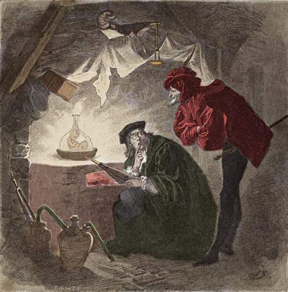
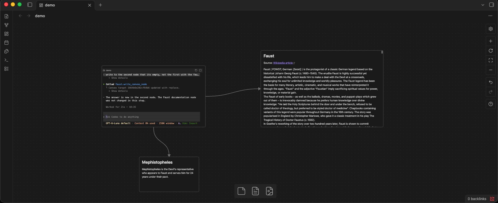

# Faust



Faust brings Pi, Codex, and Claude Code into [Obsidian Canvas](https://obsidian.md/canvas). Give an agent context by connecting it to Canvas text or file nodes, then choose explicit connected nodes as write targets. Each agent session stays attached to its own Canvas card.

> *Was du ererbt von deinen Vätern hast, erwirb es, um es zu besitzen.*
>
> “What you have inherited from your fathers, acquire it to make it your own.”
>
> — Johann Wolfgang von Goethe, *Faust I*, “Night”

Faust is a standalone plugin that handles `agent-harness` blocks rendered inside Canvas cards.

## Screenshots



## Contents

- [Features](#features)
- [Installation](#installation)
- [Usage](#usage)
- [Configuration](#configuration)
- [Limitations](#limitations)
- [Development](#development)
- [Special thanks](#special-thanks)

## Features

- Add an agent harness card from the Canvas context menu or command palette.
- Choose the default harness provider in Faust settings.
- Read connected text and file nodes as agent context through Faust's MCP tools.
- Write to explicitly connected text or file nodes, with live target validation and acknowledgements.
- Keep each agent session attached to its Canvas card.

## Installation

Faust is a desktop-only Obsidian plugin. Its MCP bridge requires Node.js 18 or newer; building requires Deno, managed through mise in this repository.

1. Run `make build` in the plugin folder. This checks for Deno, installs dependencies, and builds `main.js` and `mcp-server.js`. **This build is required for the plugin to work.**
2. Place the folder at `<vault>/.obsidian/plugins/faust/`.
3. Enable **Faust** in Obsidian's Community plugins settings.
4. If Deno is missing, install [mise](https://mise.jdx.dev/getting-started.html), then run `mise install` in this repository to install the Deno version selected by `mise.toml`.

### macOS and `node-pty`

Faust runs `node-pty` in a separate Node.js process. Node.js must be installed on your Mac. Faust checks common locations such as `/opt/homebrew/bin/node`, `/usr/local/bin/node`, `/usr/bin/node`, and `PATH`. If it cannot find Node.js, set **Node.js path** in Faust settings.

`node-pty` is a native addon and must be installed for the Mac's OS and architecture. Run the dependency-install command from step 1 on the Mac where Obsidian will use it; do not copy `node_modules` from another operating system or architecture. If the native build needs Apple's Command Line Tools, install them with:

```bash
xcode-select --install
```

If syncing or copying the plugin strips the executable bit from `node-pty`'s macOS helper, restore it with:

```bash
chmod +x "<vault>/.obsidian/plugins/faust/node_modules/node-pty/prebuilds"/darwin-*/spawn-helper
```

## Usage

1. In **Settings → Faust**, choose the default harness provider: Pi, Codex, or Claude Code.
2. Open a Canvas and add a Faust harness with the Canvas context menu or the **Add Faust harness to Canvas** command. The new card uses the provider selected in settings.
3. Connect text or file nodes directly to the harness: incoming connections provide context, and outgoing connections make nodes available as write targets.
4. Start using the harness card to open its agent session.

Faust uses direct connections to determine context and available write targets. Write operations are restricted to connected text or file nodes and are validated against the current Canvas state.

## Configuration

Open **Settings → Faust** to choose the default provider for new cards, set executable paths for Pi, Codex, and Claude Code, select a launch shell, adjust console font size, and set the Node.js path. Provider choice is part of Faust customization and is set here before building a Canvas workflow. Leave executable and Node.js paths empty to use automatic detection or the command available on `PATH`.

## Limitations

- Connections must be directly between a harness and a text or file node. Context is not gathered through other connected nodes.
- Canvas groups are not supported.
- Images, web pages, PDFs, and other node types are not supported as context or write targets.

## Development

Edit files in `src/`, then run `deno task build` to generate `main.js` and `mcp-server.js`. Run `deno task dev` to rebuild on changes, `deno task test` for unit tests, and `deno task check` for type checking.

## Special thanks

[Open Terminal](https://github.com/m4rri4nne/open-terminal-obsidian) was an important inspiration for Faust. Special thanks to [m4rri4nne](https://github.com/m4rri4nne) for the original project, without you this plugin wouldn't exist 🖤.
